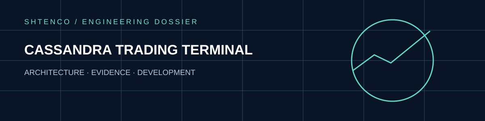
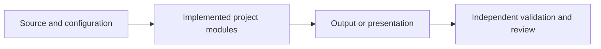
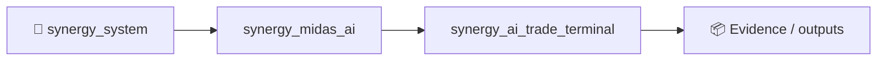
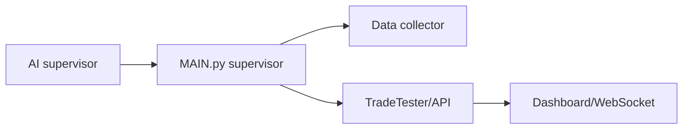

<div align="center">



**Trading research supervisor, data collector and dashboard**

[Overview](#verified-overview) · [Architecture](#architecture-map) · [Evidence](#evidence-boundary) · [Documentation](#original-technical-documentation)

</div>

## Verified overview

Trading research supervisor, data collector and dashboard. Main repository entry: `MAIN.py`. This page presents a research or engineering codebase and does not imply verified production deployment.

## Architecture map



The diagram represents conceptual flow; it does not assert a live deployment.

## Evidence boundary

> Execution-related controls require independently tested risk controls and authenticated interfaces.

| Domain | Interpretation |
|:--|:--|
| Repository files | Inspectable implementation artifacts |
| Test and CI results | Require separate current run evidence |
| Performance metrics | Require timestamped and reproducible evaluation |
| Production claims | Not established solely by documentation |

## Original technical documentation

---

# Cassandra System Manager

Единая точка запуска всей системы Cassandra.

## Быстрый запуск

```bash
python MAIN.py
```

## Архитектура системы

```
MAIN.py (process supervisor v2)
├── Config loader (config.json + defaults)
├── DataCollector process (cassandra_ai_collector.py)
├── TradeTester process (cassandra_v6_FIXED.py API server)
└── Auto-restart monitor + graceful shutdown
```

## Компоненты

### DataCollector
- Сбор данных для AI тренировки
- Поддержка нескольких тикеров
- Оптимизированный сбор

### TradeTester
- Торговый тестер
- Управление позициями
- Автоматический мониторинг

### DataHub
- Обмен данными между процессами
- Кэширование
- WebSocket обновления

## Конфигурация

Файл: `config.json`

Ключевые параметры:
- `data_dir` - директория для данных
- `log_dir` - директория для логов
- `api_port` - порт API
- `tickers` - список тикеров для сбора
- `trade_config` - настройки торговли

## Управление

### Запуск
```bash
# Стандартный запуск
python MAIN.py

# С отладкой
python MAIN.py --debug
```

### Остановка
- Ctrl+C - корректная остановка
- SIGTERM - сигнал остановки

### Перезапуск
```bash
# Через интерфейс
python MAIN.py --restart

# Через сигнал
kill -SIGUSR1 <PID>
```

## Мониторинг

### Логи
- Консольный вывод
- Файловые логи в `logs/`

### Статус
```bash
# Проверка статуса
python MAIN.py --status

# Просмотр логов
tail -f logs/system_*.log
```

## Интеграция с дашбордом

Дашборд автоматически подключается к DataHub через WebSocket.

### Доступные данные
- OHLC данные
- Стакан цен
- Объемы торгов
- Статистика торговли

## Производительность

Система оптимизирована для:
- Максимальной скорости сбора данных
- Эффективного использования ресурсов
- Автоматического масштабирования

## Ошибки и восстановление

### Автоматическое восстановление
- Перезапуск сбойных процессов
- Проверка целостности данных
- Восстановление соединений

### Ручное управление
```bash
# Перезапуск конкретного компонента
python MAIN.py --restart collector

# Полная перезагрузка
python MAIN.py --restart all
```

## Разработка

### Требования
- Python 3.8+
- Библиотеки: requests, flask, numpy, pandas

### Структура проекта
```
cassandra/
├── MAIN.py          # центральный менеджер
├── config.json      # конфигурация
├── README.md        # документация
├── logs/           # директория логов
├── ai_training_data/ # данные для AI
└── dashboard.html   # веб-интерфейс
```

## Лицензия

MIT License

## Что улучшено в архитектуре (v2)

- `MAIN.py` теперь выступает как supervisor: поднимает компоненты в отдельных процессах, следит за их состоянием и перезапускает при падении.
- Конфиг централизован в dataclass `Config` с загрузкой из `config.json`.
- Единый logger создаёт консольный и файловый канал для всех компонентов.
- Добавлена безопасная остановка (`terminate` → `kill`) для исключения зависших процессов.


## Dashboard v11+ (AI Supervisor + Executor)

- Добавлены панели **AI-чат Supervisor** и **Робот-исполнитель + логи** над блоком 1-click.
- 1-click BUY/SELL теперь исполняет вход и автоматически ставит TP/SL из текущих настроек.
- Добавлен watchdog котировок с авто-переподключением инструментальных хабов при задержке потока.
- Для OpenRouter/DeepSeek добавлен модуль `cassandra_deepseek_supervisor.py` и legacy-вход `запуск дипсика.py`.


<!-- SYNERGY-FEDERATION-PASSPORT:START -->
---

## 🧭 SYNERGY federation passport

**Домен:** 📈 Trading terminal / control plane  
**Архитектурный родитель:** [`synergy_midas_ai`](https://github.com/Shtenco/synergy_midas_ai)  
**Архитектурный корень:** [`synergy_system`](https://github.com/Shtenco/synergy_system)



Эта диаграмма фиксирует место в документационной федерации. Реальная code/runtime dependency должна подтверждаться отдельными артефактами.

### Навигация

- [📚 Атлас всех 75 репозиториев](https://github.com/Shtenco/synergy_system/blob/main/docs/SYNERGY_REPOSITORY_ATLAS.md)
- [🧾 Машиночитаемый registry](https://github.com/Shtenco/synergy_system/blob/main/registry/SYNERGY_REPOSITORIES.json)
- [🧭 SYNERGY SYSTEM](https://github.com/Shtenco/synergy_system)

### Evidence rule

`GREEN` присваивается только воспроизводимым утверждениям. Исследовательский код, диаграмма или заявленная метрика без проверяемого artifact trail остаются `R&D/CANDIDATE`.

<!-- SYNERGY-FEDERATION-PASSPORT:END -->

---

# 🖥️ Глубокий технический паспорт Cassandra Terminal

## Фактический `main`

```text
MAIN.py
cassandra_ai_collector.py
cassandra_v6_FIXED.py
cassandra_deepseek_supervisor.py
WALK_FORWARD_2_YEARS.py
dashboard.html
config.json
```

Это реальный legacy supervisor/terminal stack, но без отдельной automated test suite.



## Основные риски

- process restart ≠ state consistency;
- AI supervisor must not gain execution authority;
- dashboard command ≠ authorized trade;
- absence of tests makes refactoring/migration risky;
- config/log/data paths need schema/versioning.

## Следующий рубеж

freeze legacy behavior → add smoke/integration tests → extract typed DataHub/execution contracts → migrate useful components into MIDAS/TradeMux/Meta-OS.
